# 校园二手交易系统软件设计与建模报告

日期：2026-10-28（公开版省略学号姓名）

### 实验二  软件设计与建模

UML：PlantUML    UI：diagrams.net（draw.io）    AI：Codex / GPT-6.1 Sol

## 1 项目与主要功能

项目为校园二手交易网站。通过统一发布、审核、检索、预约和结果记录，减少群聊信息分散与重复预约。普通账号可兼任买卖双方；管理员承担审核、违规处理、平台统计及日志查询。访客仅能浏览公开商品。

本期覆盖账号注册登录、商品草稿与审核、组合查询、预约快照、接受拒绝、阶段取消、卖家确认完成、违规下架锁定、统计和日志。每件商品只对应一件物品，最多一条有效预约。付款和交接在线下进行，不引入在线支付、物流、聊天、评价、退款或仲裁。

实验2交付的是设计模型与中保真界面，不是已实现的交易系统。界面中的商品、账号编号、笔数、金额及时间均为示例数据；不作为真实交易或性能测试证据。REQ-026的环境仍待甲方确认。

## 2 模块划分及依赖

| 模块 | 功能 | 需求编号 REQ | UI编号 | 责任边界 |
| --- | --- | --- | --- | --- |
| M01 | 身份与授权 | 001–003、017、020、023 | UI01 | 注册、登录、退出、一次性邀请码；按角色和归属验证每个请求。 |
| M02 | 商品发布与管理 | 004–008、022 | UI04、UI05 | 草稿、合法价格、提交撤回、修改重审、三态下架及原因。 |
| M03 | 商品查询 | 010、025、026 | UI02、UI03 | 关键词与组合筛选、分页、详情、价格倒置与空结果提示。 |
| M04 | 预约与交易 | 013–017、020–022 | UI03、UI06–UI09、UI14 | 预约快照、接受拒绝、阶段取消、不可撤销完成、阶段联系权限。 |
| M05 | 审核与违规 | 006、009 | UI10、UI11 | 审核原因、违规下架锁定、解锁、已售出只追加历史。 |
| M06 | 统计查询 | 011–012、026 | UI12 | 卖家自身与全平台范围；北京时间完成日期和预约价统计。 |
| M07 | 日志与历史 | 018–019、023–024 | UI06、UI09、UI13 | 普通用户自身历史；管理员查询成功、失败及恢复补录日志。 |

采用浏览器展示层、应用服务层、领域模型与仓储层的模块化单体。账号模块提供身份与归属校验；商品模块维护生命周期；预约模块与商品联动；审核模块可触发下架和预约终止；统计、历史模块读取授权范围内的已保存事实。组件图表达调用与依赖，不代表部署成七个独立微服务。

所有受保护命令都经过应用入口，先检查当前登录与对象权限。查询也由服务端限制范围；公开查询过滤违规与非公开状态，卖家查询限定本人，管理员使用独立权限。界面上隐藏按钮只改善操作体验，不能作为授权机制。

## 3 数据存储与一致性设计

采用关系数据库保存业务对象，金额按整数分保存，时间保存为统一时间点，界面和日期筛选按北京时间解释。用户名、各记录编号唯一；商品、预约、用户、处理历史使用外键关联。下列约束和实现策略为乙方设计选择，后续实现可调整，但不得削弱已确认需求。

| 数据对象 | 保存形式及关键约束 |
| --- | --- |
| 用户及角色 | 用户名唯一、密码只保存安全哈希；角色集合支持普通账号同时买卖；管理入口额外检查管理员身份。 |
| 商品 | 八种业务状态，违规锁定为独立标记；priceFen范围1～9999999；version用于条件更新，已售出禁止回退。 |
| 预约及快照 | itemId、buyerId、六种预约状态、标题/价格/地点快照、原因、实际完成时间；结束记录不复用。 |
| 唯一有效预约 | 对等待确认、待交接建立按itemId的唯一约束（支持时用部分唯一索引）；与商品状态条件更新共同防止并发双成功。 |
| 联系方式 | 单独的私有联系表，按预约关联；字段加密，密钥不进仓库；结束后保留数据但双方读取一律拒绝。 |
| 管理员邀请码 | 仅保存校验哈希与消耗时间；校验、消耗和管理员账号创建同事务，避免重复取得管理身份。 |
| 审核及日志 | 审核违规历史只追加；成功日志和业务同事务；失败日志独立持久化，数据库故障先受控追加本地。 |
| 同次操作回执 | actorId与requestId组合唯一，另校验操作、目标与输入摘要；只保存结果引用，不能缓存可绕过权限的联系原文。 |

商品状态为草稿、待审核、已驳回、已发布、已预约、待交接、已售出、已下架。预约状态为等待确认、待交接、已取消、已拒绝、已终止、已完成。前两者有效，分别配对商品已预约、待交接；其他商品状态无有效预约。

### 3.1 跨模块事务

预约、接受、拒绝、取消、下架和完成以一次事务保存相应商品、预约、历史及成功日志。条件更新失败、约束冲突或任一步保存失败均回滚。违规处理同时终止有效预约并锁定商品；解锁只清除锁定标记，不发布商品。竞争中的完成和取消最多一个成功。

命令先授权，再判断是否同次请求。成功重发复用原处理结果而不新增业务或成功日志，返回前按当前权限与预约状态重新裁剪私有数据；退出登录必须先拒绝。处理中返回可查询状态。临时保存失败且无业务更新时允许以原标识重试并重检；非法输入、越权或冲突修正后重新提交使用新标识；取消后重约建立新记录。

### 3.2 联系与日志边界

买家预约成功后卖家可读买家联系；卖家接受并提供联系后买家可读卖家联系。结束预约后，双方页面、直接请求与旧成功请求重发都不能取回联系。前端同时清除已加载联系，禁止持久化到本地缓存；服务端对每次读取执行阶段授权。管理员因管理需要可在独立核查入口查看私有数据，普通列表和日志始终不展示。

失败日志记录已提交到服务端的越权、冲突、非法输入、保存失败，保留时间、动作、对象（如有）、已知操作者、请求标识和原因；匿名不虚构身份。写入独立事务，数据库不可用时追加本地故障日志，恢复后按稳定日志/请求标识补录去重。记录经字段白名单构造，不序列化完整请求，不保存密码、联系或邀请码原文。

## 4 四种UML图及选择理由

| 图 | 所属类别 | 本项目选择理由 |
| --- | --- | --- |
| 01 类图 | 必画，结构性 | 表达账号复用买卖角色、商品与多次历史预约、私有联系、处理历史及请求回执的关系。 |
| 02 组件图 | 结构性另选 | 展示七模块、应用入口、共享事务和独立失败日志之间的依赖，解释整体架构。 |
| 03 商品状态图 | 行为性 | 项目核心是审核、预约、交接和下架的八态约束，状态图能暴露非法回退或遗漏转换。 |
| 04 预约时序图 | 交互性 | 展示单次预约中的授权、同次操作处理、竞争、事务提交/回滚和失败留痕顺序。 |

四图均使用PlantUML源码渲染，名称明确且类型不同；不是把“时序图”和“序列图”当作两种凑数。类图侧重领域关系，组件图侧重模块，状态图侧重允许路径，时序图侧重运行顺序，四者互补。源码随包交付。

### 4.1 类图说明

用户与商品为一对多，用户以买家身份与预约为一对多，商品与历史预约为一对多，预约组合拥有一份私有联系数据。没有买家和卖家的互斥子类，符合一个账号可以同时买卖的需求。日志操作者可空，适用于未登录失败；日志与审核历史不随商品删除而消失。

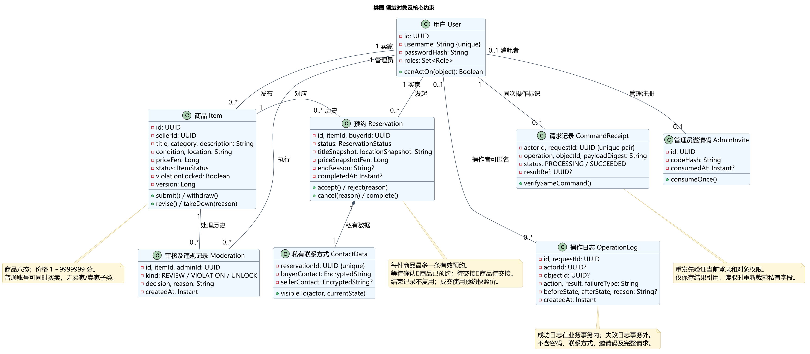

PlantUML原图及对应.puml源码随包提供。

### 4.2 组件图说明

命令协调器统一管理请求回执和事务，领域模块负责合法状态转换，仓储执行持久化。选择单体是因为下架、预约和日志必须原子生效，课程原型中不必引入分布式事务。独立失败写入器位于失败路径，不受业务回滚影响，恢复补录属于管理日志链路。

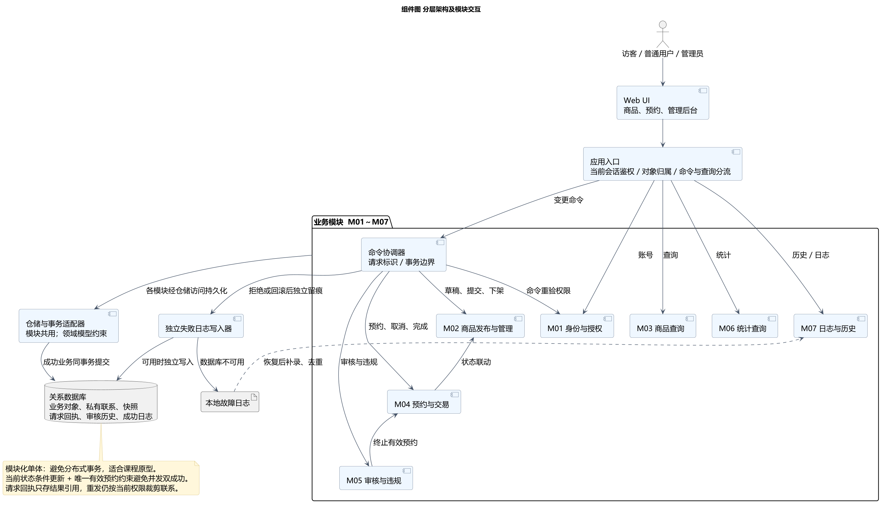

PlantUML原图及对应.puml源码随包提供。

### 4.3 状态图说明

卖家仅能下架已发布、已预约、待交接商品，有预约必须有原因并终止预约；管理员可对待审核及上述在售状态违规下架并锁定。等待确认取消只归买家，卖家拒绝需原因；待交接取消任一方需原因。已售出仅可追加违规历史，任何角色均无恢复在售路径。

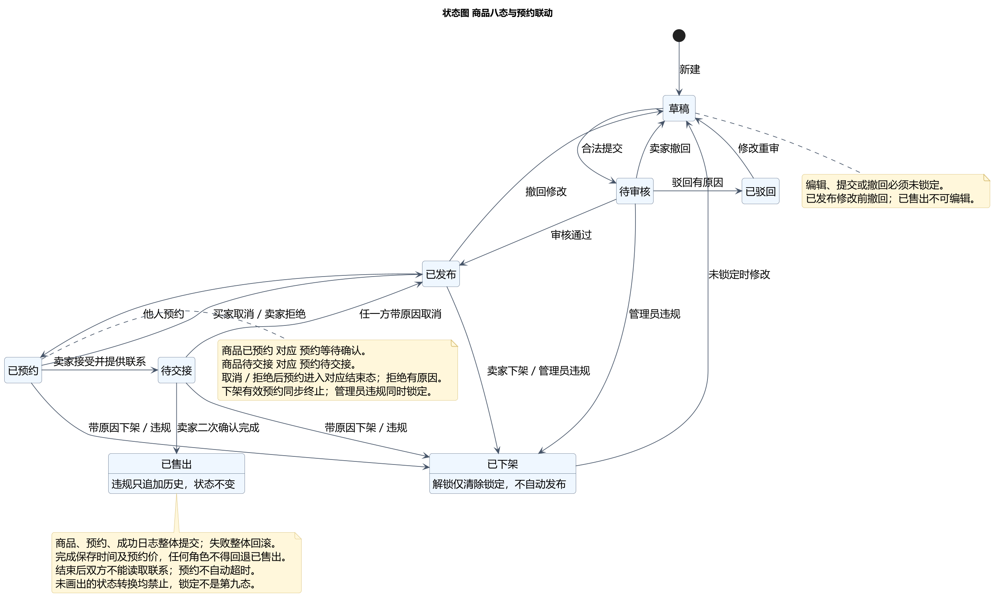

PlantUML原图及对应.puml源码随包提供。

### 4.4 时序图说明

只画最容易发生并发和重发问题的预约创建场景，不把整个系统硬塞进单张交互图。先验证当前身份，再查命令回执；事务内争取唯一命令处理权，复核状态并条件占用商品，写预约、快照、联系和成功日志。失效或失败不保留部分业务，事务外保存失败记录。接受、取消与完成复用同样的协调边界。

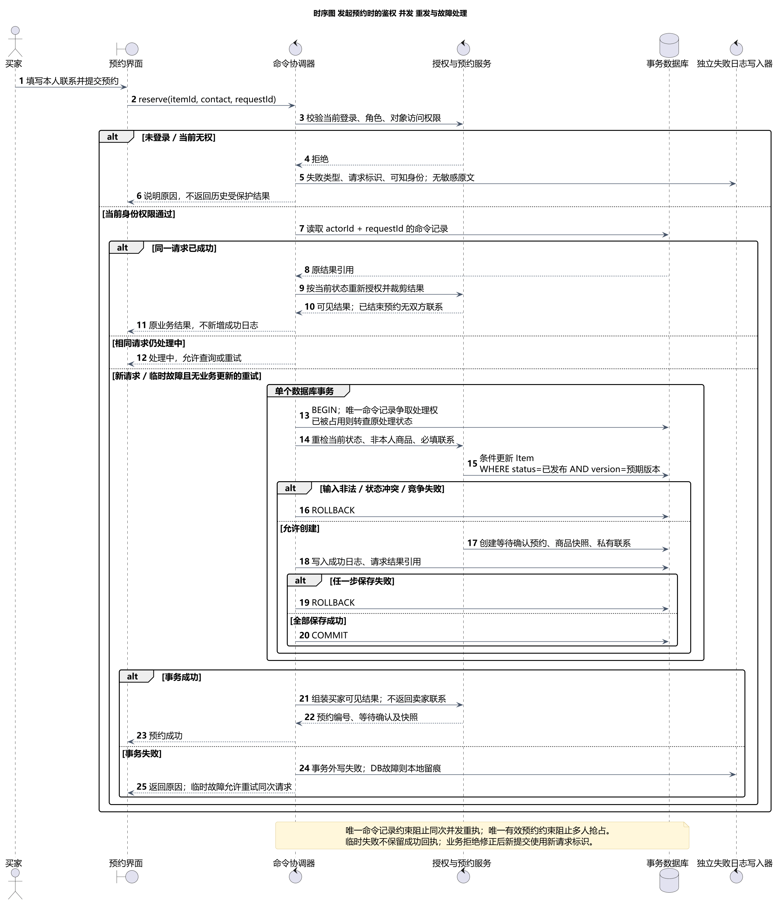

PlantUML原图及对应.puml源码随包提供。

## 5 UI界面与模块功能说明

采用diagrams.net（draw.io）作为UI设计工具，原稿为14页原生可编辑mxGraph画板，控件为可编辑图形及文字，不是把截图贴进源文件。工具导出PNG供提交和报告使用；页内导航链接用于表达页面流转。静态原型中的按钮不执行真实业务。

统一使用深色侧栏、蓝色主动作、红色危险动作；标题、表单标签和错误提示直接说明当前动作。普通账号与管理员采用不同菜单。公开商品不出现私有联系；危险动作需要原因或二次确认；结束历史页保留事实和原因，不保留双方联系入口。

页面流：UI01→UI02→UI03→UI06→UI14；卖家由UI04/05维护商品，由UI07接受后进入UI08，结束进入UI09；管理员由UI10/11处理审核违规，UI12查询统计，UI13查询日志。UI12根据角色固定查询范围，不允许卖家手工改成其他卖家或全平台。

### UI01 注册与登录

角色：访客。关联：REQ-001–003、023、025。同一普通账号可兼任买卖角色；管理员通过单独的一次性邀请码注册入口。

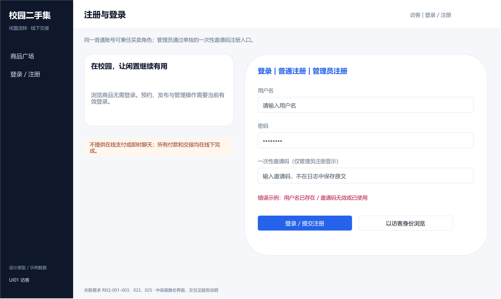

### UI02 商品广场

角色：普通用户。关联：REQ-010、025、026。关键词匹配标题或描述；其他筛选条件同时满足。公开仅展示非违规的四种商品状态。

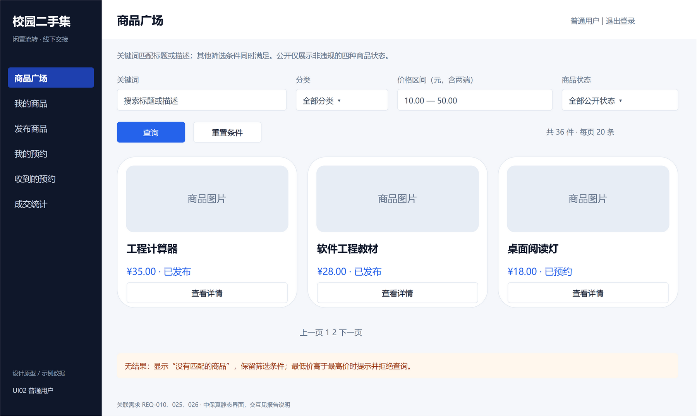

### UI03 商品详情与预约

角色：普通用户。关联：REQ-010、013、017、020–021、025。可预约状态：已发布、非本人商品、无有效预约；提交时以服务端当前状态为准。

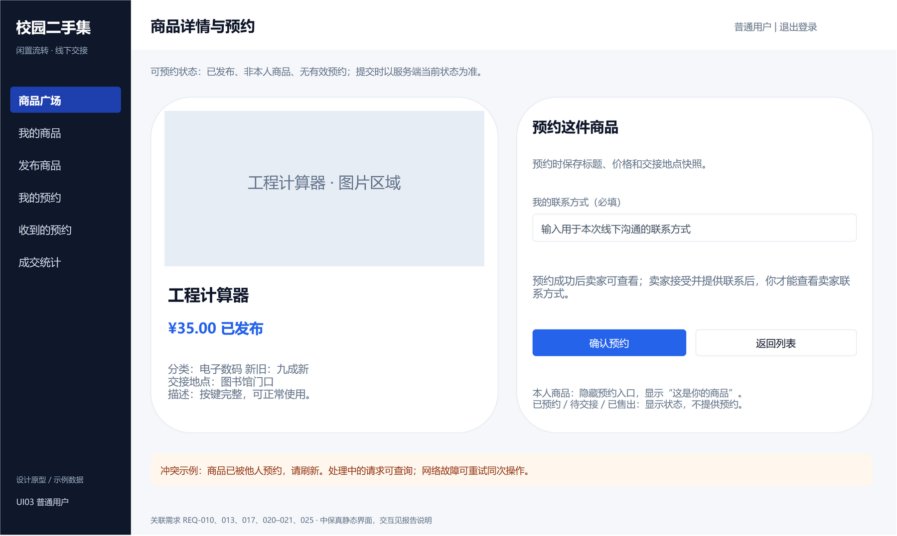

### UI04 我的商品

角色：普通用户。关联：REQ-004–008、011、022。仅展示本人全部商品；按钮随当前状态变化，预约中和待交接商品不能修改。

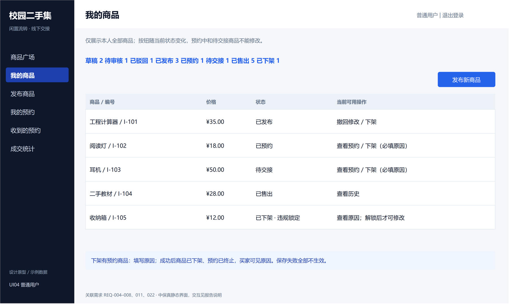

### UI05 商品编辑与提交

角色：普通用户。关联：REQ-004–007、025。草稿可保存不完整内容；提交审核前完成所有必填项。已发布需撤回，已下架需未锁定才能修改重审。

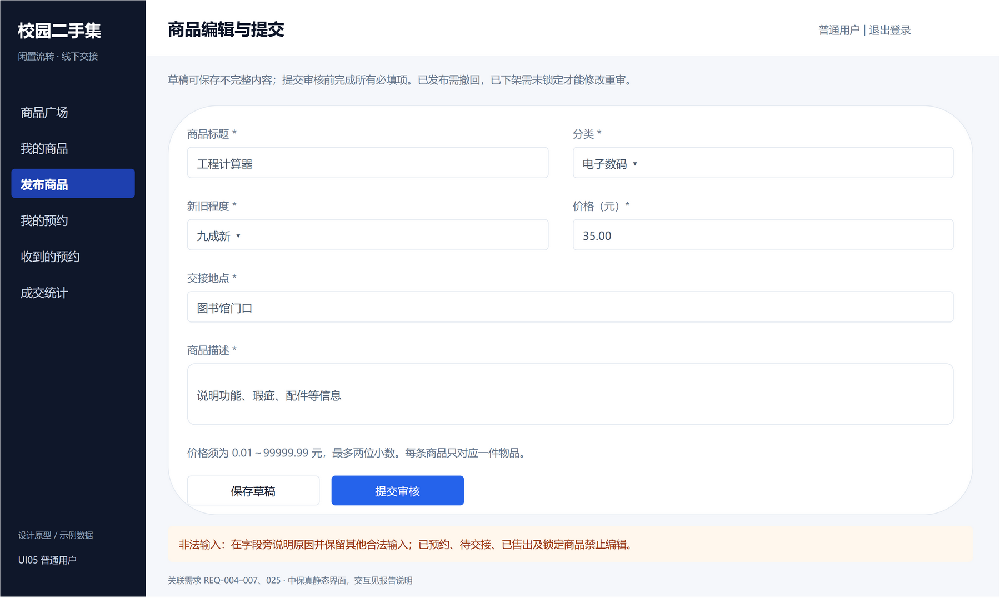

### UI06 我的预约与交易历史

角色：普通用户。关联：REQ-003、013、015、017–018。只查询本人的预约；结束记录保留商品快照、原因、状态和时间，不再展示联系方式。

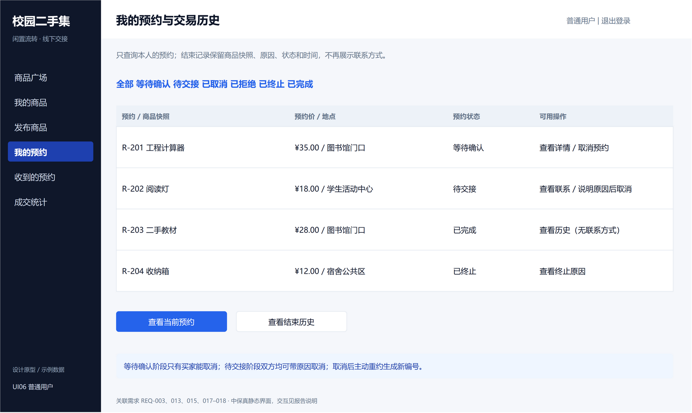

### UI07 处理收到的预约

角色：普通用户。关联：REQ-014、017、020–022。仅商品卖家可处理等待确认预约；接受提供本人联系，拒绝填写原因，二者不能混用。

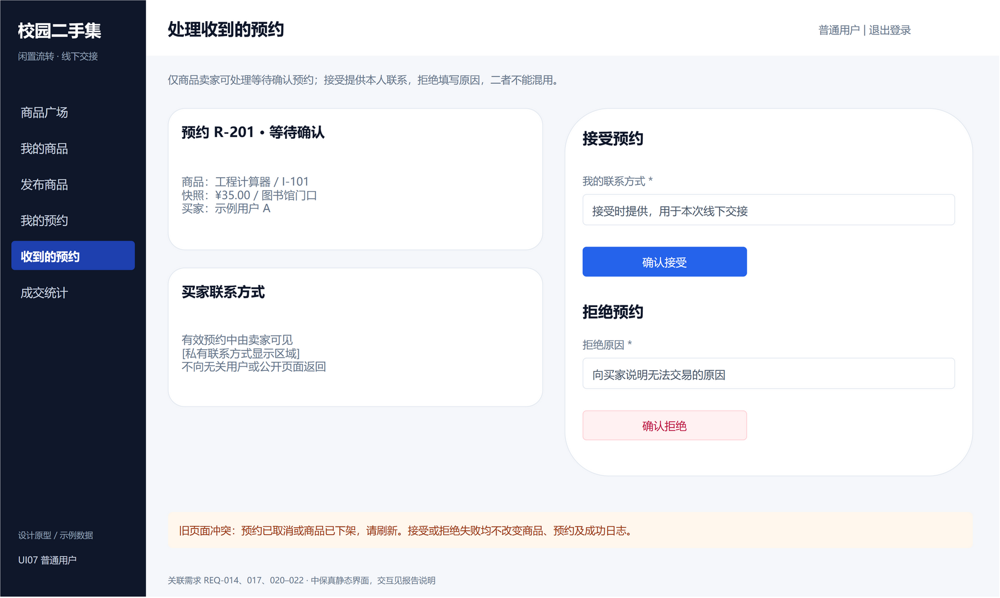

### UI08 线下交接与完成确认

角色：普通用户。关联：REQ-015–017、020–021、025。当前预约待交接，图示卖家视角；买家视角只有取消和查看卖家联系，没有确认完成按钮。

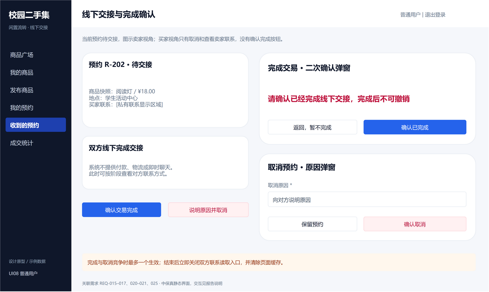

### UI09 已结束预约详情

角色：普通用户。关联：REQ-008、015–018、022、027。适用于已取消、已拒绝、已终止、已完成；不提供修改、恢复、申诉、仲裁或退款入口。

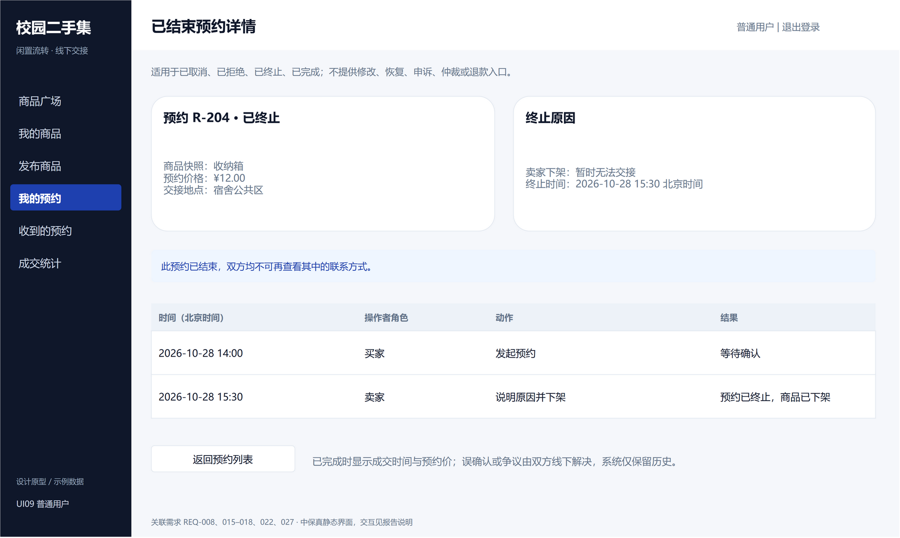

### UI10 商品审核

角色：管理员。关联：REQ-003、005–006、018、021。只审核当前待审核商品；通过后发布，驳回必须有原因。普通用户不能进入或调用该操作。

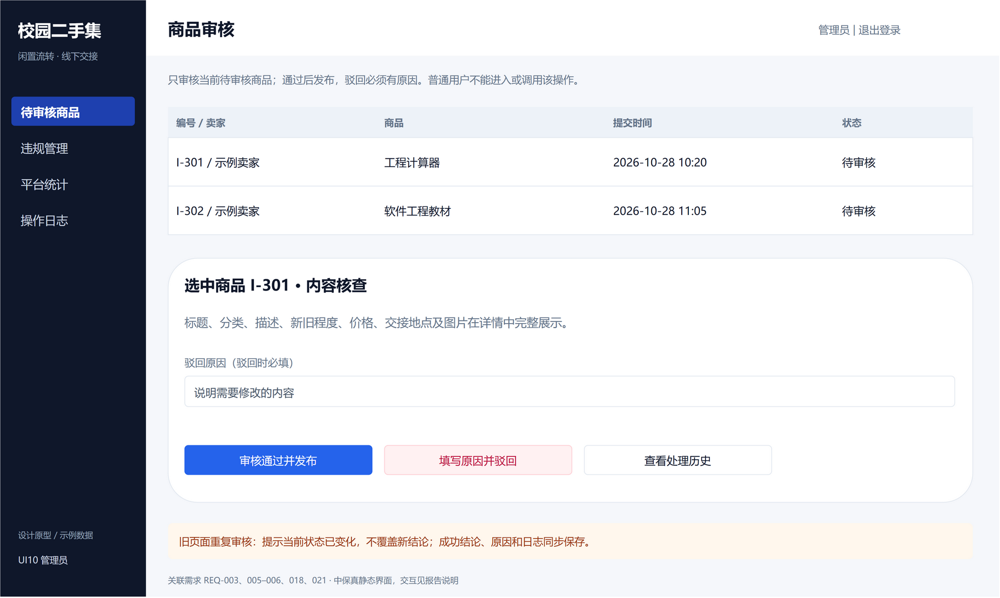

### UI11 违规处理与锁定

角色：管理员。关联：REQ-003、007–009、017–018、022。违规下架并锁定；解除锁定只允许卖家修改重审。已售出商品仅追加违规历史。

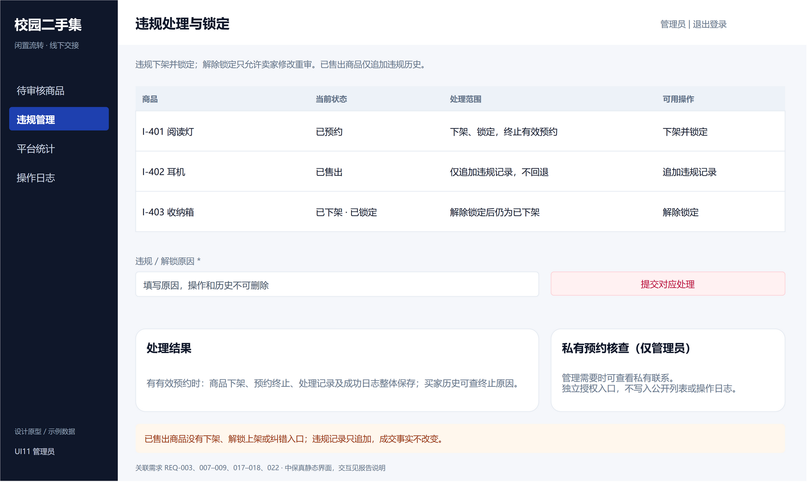

### UI12 商品与成交统计

角色：管理员。关联：REQ-003、011–012、026。同一页面按角色限制范围：卖家只能看自己；管理员可看全平台。以下均为示例数据。

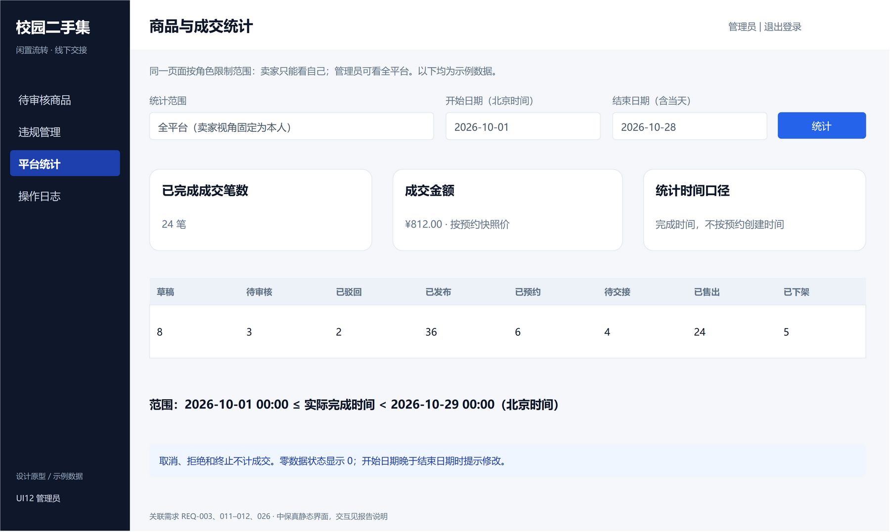

### UI13 成功与失败操作日志

角色：管理员。关联：REQ-003、018–020、023–024。只读查询；失败日志独立留存，数据库故障可先本地记录，恢复后可查询。日志无敏感原文。

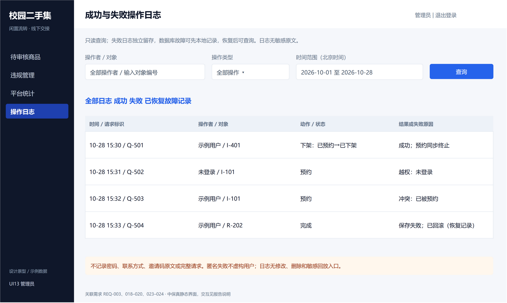

### UI14 买家待交接详情

角色：普通用户。关联：REQ-003、014–017、025。当前为买家视角：卖家已接受，可查看卖家联系；买家不能确认完成，只能按规则取消预约。

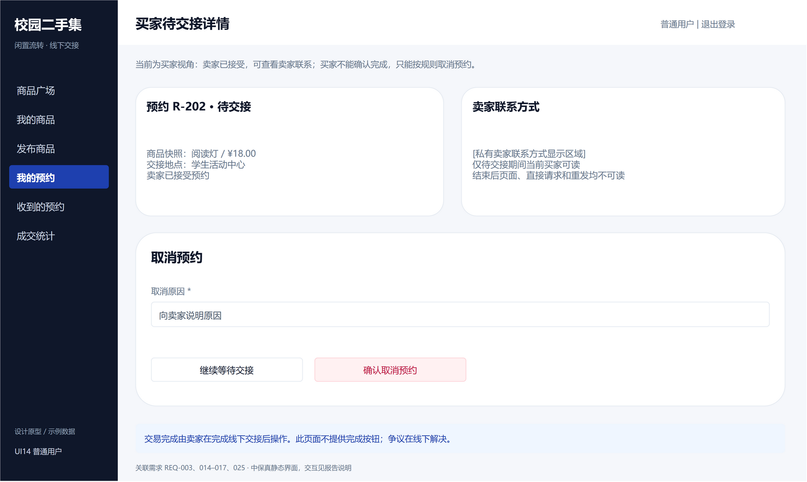

## 6 非功能需求与设计验证

安全方面，角色、归属及联系阶段在服务端校验，日志使用白名单字段。可靠性方面，用条件更新、唯一有效预约和成功日志同事务防止部分保存，失败日志独立。易用性方面，非法字段明确标注原因且保留其他合法输入；失权的联系不因输入保留而重显。

性能设计采用分页查询（每页20条），按状态、分类、价格与归属建立适合查询的索引；关键词在标题或描述任一字段匹配，不能改成两个字段必须同时满足。统计时间区间为北京时间开始日00:00至结束日次日00:00前，只计实际已完成预约并求和快照金额。索引和查询计划需在后续数据规模下验证，不声称现已达到性能指标。

验收计划保持原口径：1万商品，20用户每人5次、总计100次，至少95次在1秒内显示文字列表，失败/超时不剔除；包括网络、服务端与文字渲染，不含图片及输入。环境和查询组合需甲方确认后固定。本轮只校验图稿语法、导出完整性、需求追踪及报告排版，没有执行后端并发或性能验收。

## 7 AI辅助工具使用过程与反思

本轮使用Codex，模型为 GPT-6.1 Sol。以下记录将AI生成与AI自行修订明确标记。用户提供的任务、实验1需求及本轮模型名称是实际输入。我已于2026-10-28查看并回复三项设计核对，结论和界面选择见7.1节。

| 使用记录 | 场景及生成结果 | 优点与缺点 | 实际优化后结果 |
| --- | --- | --- | --- |
| AI2-001 | 读取课程要求和27条需求，生成7模块与4份PlantUML源码，保存AI初稿提交。 | 快速保持编号与跨图联系；初版组件和状态图过宽，自动布局不保证纸面可读。 | AI改为分层紧凑组件布局、缩短状态转换标签，完整条件移到说明；扩大渲染限制，避免边缘被截断。 |
| AI2-002 | 将功能和异常路径转换为14页draw.io原生UI画板。 | 易于统一导航、危险动作和需求映射；静态原型不能证明服务端授权、事务或性能正确。 | 将等待确认、待交接、结束历史分开；补充两类确认/原因弹窗和管理员私有核查入口；导出后逐页检查。 |
| AI2-003 | 整理数据设计、界面说明、AI记录，生成Word及PDF并打包。 | 可建立源码、界面、报告对应关系并检查缺件；容易把设计建议写成已确认需求，或伪造人工修改。 | 明确标注乙方设计、性能待确认；用真实Git提交区分初稿、AI修订和本人审查后的记录更新，不把保留意见冒充改图。 |

### 7.1 我的审查与设计选择

我查看图稿和相关页面后，在本轮沟通中作出以下判断：

| 编号 | 核对对象与可选方案 | 实际回复 | 对结果的影响 |
| --- | --- | --- | --- |
| R2-01 | 状态图、时序图、UI08及UI14；三态下架整体保存、结束后联系关闭、仅卖家二次确认完成。 | 已查看，三项均保留 | 保留状态、事务及权限边界，跨图和页面保持一致。 |
| R2-02 | UI14取消原因：详情页内填写，或点击取消后再弹窗填写。 | 保留详情页内填写原因 | 选择页内原因方案，保留UI14；不改为弹窗。 |
| R2-03 | 模块化单体＋关系数据库；理由为商品、预约和成功日志可同事务保存。 | 采用，并保留这项理由 | 采用该架构，保留共享事务与独立失败日志设计。 |

这轮核对使我把业务不可撤销、隐私和事务边界同实际界面关联起来，并在两种取消原因交互中选择保留页内填写。其余技术细节仍是乙方设计；甲方未新增确认技术选型。后续如我亲自修改图稿或提出修改意见，会另行保留原设计、修改内容、理由及Git提交，不把“审查后保留”写成不存在的人工改图。

### 7.2 可复用工作流与局限

可采用“冻结需求编号→生成模块与约束清单→生成可编辑UML和UI→工具检查语法与导出→跨图核对→本人逐项审查→按意见修订→再次校验和提交”的工作流。AI适合产生备选方案、追踪遗漏与执行重复排版，自动脚本适合检查文件、编号和语法。

人可以主要承担检查校对，但不能只看美观或只点通过。未知业务条件仍要由甲方确认，权限、事务、不可撤销操作和范围取舍必须由本人理解并判断；图能渲染不代表设计正确，原型可看不代表实现可用。本轮的实际经验也显示，AI生成的图可能过宽，工具转换和逐页检查不可省略。因此不能让系统自动伪造“人工修改完成”以闭合流程。

## 8 版本与交付

当前仓库：https://github.com/unfinities/software-engineering-labs 。

基线为lab1-final提交6bd983d432468305da23e1d370a0c0846316c302，

AI设计初稿lab2-ai-draft对应034610237b0c34acff6a9861afeee32a2fc4154a，

AI图稿修订对应dbe38a07f09477169ca07ca657ad6a3d53402aaf。

三项审查及其记录更新另作Git提交。导出清单见delivery-manifest.json。实验1标签及已提交文件不移动或覆盖。

提交ZIP按网页要求包含“实验2_学号_姓名/实验报告.pdf”、UML目录下四组同名PNG和PUML，以及UI界面目录下14张PNG。可编辑Word、draw.io原稿及审查记录另行提供，方便本人修改。三项本人审查已经记录，结论均为保留；本轮没有发生本人改图。后续本人修改应继续用Git单独保存，不能以AI改稿代替人工修改记录。

## 参考资料

课程来源：用户提供的detail.htm本地网页，实验二软件设计与建模；不将含课程会话信息的原网页提交公开仓库。

PlantUML官方语法及命令行文档：https://plantuml.com/class-diagram 、https://plantuml.com/state-diagram 、https://plantuml.com/sequence-diagram 、https://plantuml.com/component-diagram 、https://plantuml.com/command-line 。

draw.io官方文档：https://www.drawio.com/docs/manual/export/export-diagram/ ；工具官方仓库：https://github.com/jgraph/drawio-desktop 。访问日期2026-10-28。
